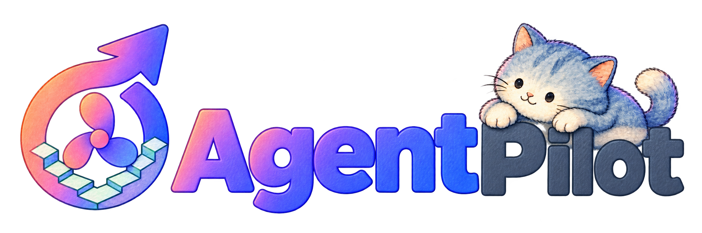
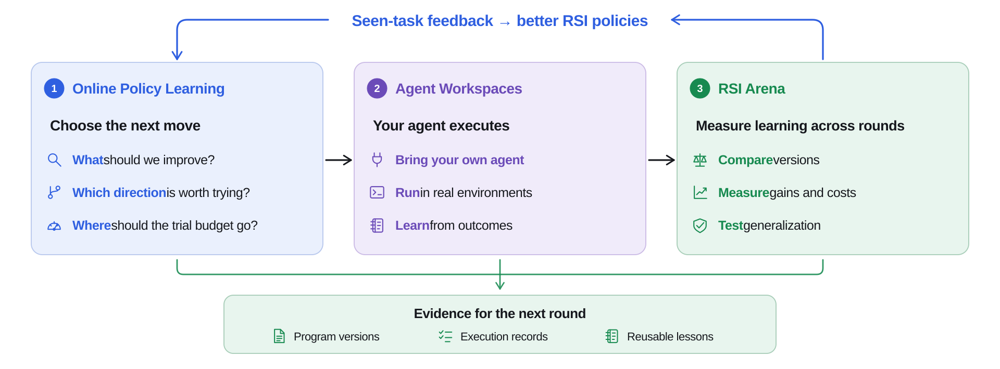
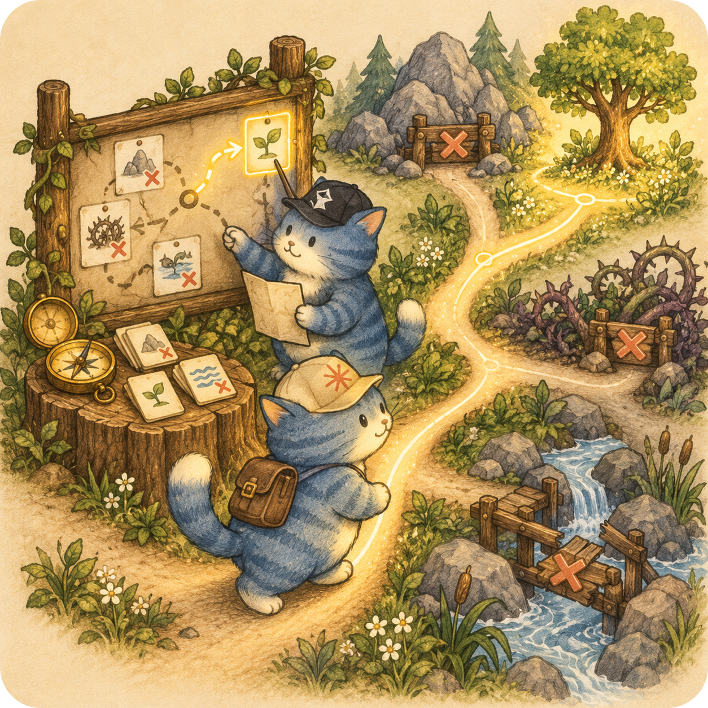
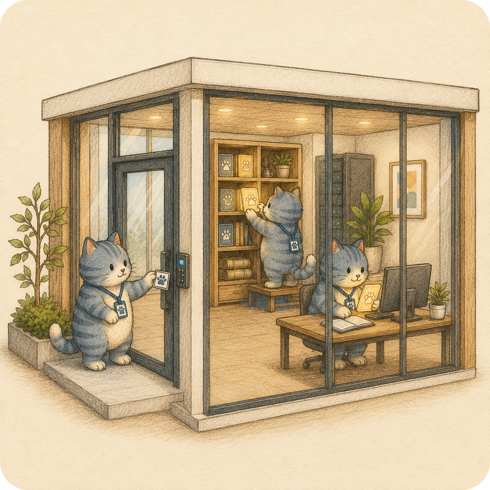
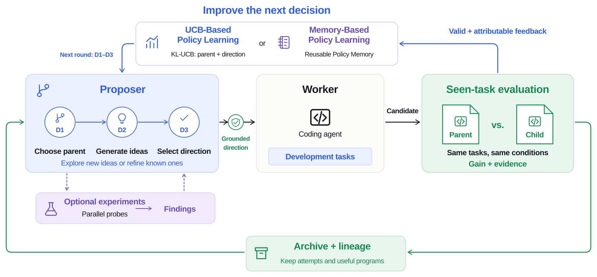
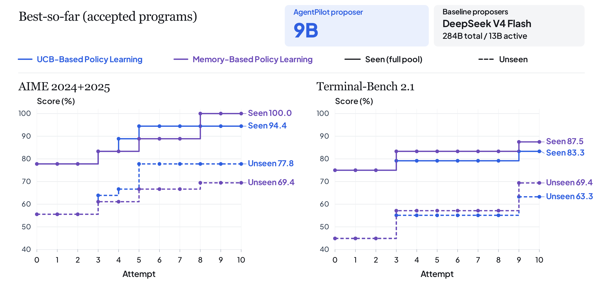
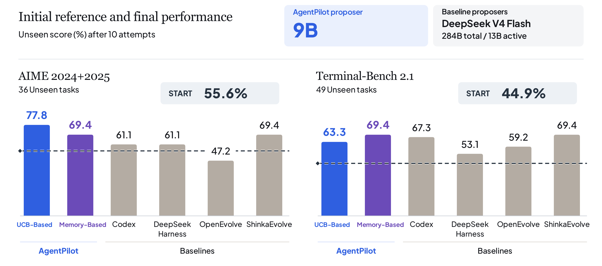
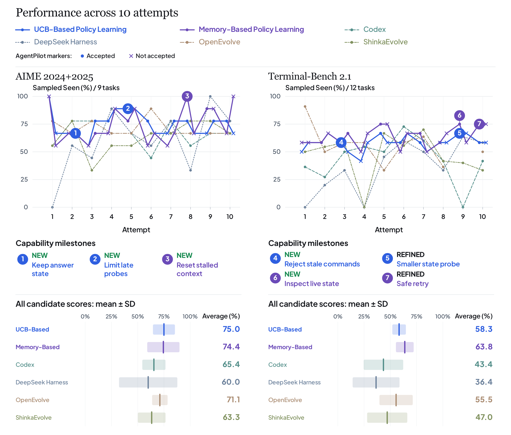
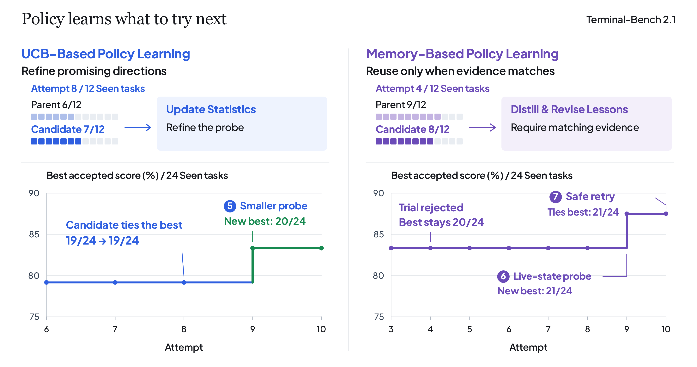

<div align="center">



## AgentPilot: Make Your Agents Move Better and Faster

[](https://www.python.org/) [](https://opensource.org/licenses/MIT/) [](./COMMUNICATION.md) [](./COMMUNICATION.md)

### ✨A 9B Strategy Model Guides Your Agent’s Next Move. Frontier Models Execute. Better Decisions. Fewer Wasted Tokens.✨

</div>

## 🎯 Why AgentPilot?

Agents can execute, but struggle to decide what's worth trying next.

AgentPilot uses a lightweight 9B strategy model to guide much larger frontier models in executing coding tasks.

AgentPilot helps your agents learn from each trial and choose a better next move:
- **What to change** based on what worked and what failed.
- **Which approach to try next** instead of repeating the same mistakes.
- **When to keep exploring—and when to stop** to avoid wasting the trial budget.

The larger model executes. The 9B model provides the strategy and improves its decisions through real feedback.

**The goal is simple**: **Better Next Moves**. **Fewer Wasted Tokens**.

### 🔌 Bring Your Own Agent
Guide Your Agent’s Next Move: [Codex](https://github.com/openai/codex), [Claude Code](https://github.com/anthropics/claude-code), [Hermes](https://github.com/NousResearch/hermes-agent), [nanobot](https://github.com/HKUDS/nanobot), [DeepSeek Harness](https://github.com/deepseek-ai/deepseek-harness), [WorkBuddy](https://www.workbuddy.ai), [Grok Bot](https://x.ai/bot).

**Your agent executes. AgentPilot is the decision system that chooses better strategies and next moves.**

It learns from every trial and guides agents toward better strategies across:

- **💻 Algorithm Development**  
  Explore better algorithms, architectures, and implementation choices.

- **🔍 Deep Research**  
  Decide which questions to investigate, which directions to pursue, and where to allocate research effort.

- **🖱️ Computer Use**  
  Learn effective action sequences, recover from failures, and complete complex tasks more reliably.

**Your agent executes. AgentPilot decides what to try next.**

Three components help your agent self-improve:

- **🧠 Online Policy Learning**: Boosting the AI's learning ability — it proposes promising designs, decides what to try next, and allocates the budget.
- **🛠️ Agent Workspaces**: Provide real execution environments to test improvements and learn from outcomes.
- **🛡️ [RSI Arena](arena/README.md)**: Test how well an AI system learns and improves, not just how well it performs once.

<p align="center">
  <a href="assets/agentpilot-overview.svg"></a>
</p>

## ✨ Key Features

### 🧠 Online Policy Learning: Help your agents decide what is worth trying next.
- 🎯 **Choose Where to Start** — Help agents decide where to begin, instead of starting from scratch each time.
- 🧭 **Decide What to Try** — Guide the next improvement by testing ideas through small, low-cost experiments.
- 💰 **Allocate the Budget** — Give more trials to what works, drop what doesn't.
- 🔄 **Strengthen Decision-Making** — Learn from every trial to make smarter decisions over time.

<table>
  <tr>
    <td width="33.33%" align="center"></td>
    <td width="33.33%" align="center"></td>
    <td width="33.33%" align="center"></td>
  </tr>
  <tr>
    <td width="33.33%" valign="top">
      <p align="center"><strong>🧠 Guide Your Agent's Next Move</strong></p>
      <p>Help your agent decide what to improve next using evidence from past attempts.</p>
    </td>
    <td width="33.33%" valign="top">
      <p align="center"><strong>💰 Spend Budget Wisely</strong></p>
      <p>Prioritize promising directions and test ideas before committing to costly evaluations.</p>
    </td>
    <td width="33.33%" valign="top">
      <p align="center"><strong>📈 Strengthen Decision-Making</strong></p>
      <p>Learn from successes and failures so the RSI policy gets better at guiding each decision.</p>
    </td>
  </tr>
</table>

### Agent Workspaces: A workspace for your agents to act, learn, and improve with every run.
- 🛠️ **Execute** — Run tasks in real environments and record what happens.
- ✅ **Evaluate** — Use outcomes to identify what worked and what failed.
- 🤝 **Reuse & Share** — Bring proven workflows into future tasks and other agents.
- 🔄 **Improve** — Refine workflows with execution feedback and validate changes before reuse.

<table>
  <tr>
    <td width="33.33%" align="center"></td>
    <td width="33.33%" align="center"></td>
    <td width="33.33%" align="center"></td>
  </tr>
  <tr>
    <td width="33.33%" valign="top">
      <p align="center"><strong>🌐 One Workspace for All Your Agents</strong></p>
      <p>Let your agents retrieve, reuse, and share workflows and past experience, so each task builds on previous progress.</p>
    </td>
    <td width="33.33%" valign="top">
      <p align="center"><strong>🔒 Your Workspace, Your Data, Your Infrastructure</strong></p>
      <p>Run agents on your own infrastructure. Keep execution data and workflows under your control, and choose what to share.</p>
    </td>
    <td width="33.33%" valign="top">
      <p align="center"><strong>📈 Workspaces That Evolve with Every Run</strong></p>
      <p>Capture task outcomes to retain effective workflows, refine unsuccessful approaches, and guide your agent's next attempt.</p>
    </td>
  </tr>
</table>

### The Skill Management Layer for AI Agents

Powered by OpenSpace, AgentPilot helps agents **Retrieve**, **Evaluate**, **Evolve**, and share skills—so each trial builds on past experience.

- 🔍 **Retrieve** relevant skills for each task.
- 📊 **Evaluate** skills through real execution outcomes.
- 🧬 **Evolve** skills with feedback and validated updates.
- 🤝 **Share** proven workflows across tasks and agents.

AgentPilot guides the next move. OpenSpace manages the skills that make it work.

### RSI Arena
Most AI benchmarks evaluate what AI can do on a fixed set of tasks.

RSI Arena evaluates AI’s ability to learn—not just what it can do once.

RSI Arena focuses on two fundamental questions:
- **Can the AI really learn?**<br>
Can it learn from feedback to self-evolve and make better decisions over time?

- **How fast can AI improve?**<br>
- Given the same number of trials and the same budget, which system learns faster and performs better?

## 📋 Table of Contents

- [🎯 Quick Start](#quick-start)
- [🚀 Technical Innovation & Implementation](#technical-innovation)
- [📊 AgentPilot in Action](#agentpilot-in-action)
  - [Learning Beyond Task Performance](#execution-vs-learning)
  - [Stronger Learning with a 9B Proposer](#learning-progress)
  - [Policy Guides Capability Discovery](#policy-and-capability)
- [📖 Code Structure](#-code-structure)
- [🔗 Related Projects](#-related-projects)

<a id="quick-start"></a>

## 🎯 Quick Start & How to Use AgentPilot

### ① Install

You don't need to read the docs, run the commands, or configure anything yourself. Paste the block below into your Agent (e.g. Codex, Claude Code — anything with terminal/file access), and let it handle the rest:

```text
Install AgentPilot as a skill for this agent.
Repository: https://github.com/HKUDS/AgentPilot
For Codex desktop, also install the local plugin for @ selection.
Keep my existing configuration and verify the installation.
```

### ② Use

In your project, choose your agent's entry below, then describe your task:

| Invoke | Agent |
| --- | --- |
| **`/agentpilot`** | Claude Code, OpenCode CLI, Cursor, Copilot CLI, CodeBuddy Code, Hermes, DeepSeek Harness, Grok Bot (Grok Build CLI) |
| **`@agentpilot`** | OpenCode |
| **`@`** → select **AgentPilot** | Codex desktop (plugin installed) |
| **`$agentpilot`** | Codex CLI, nanobot |
| Import the skill ZIP, then select **AgentPilot** | WorkBuddy |

Example task: `Help me improve this project's performance and make it run faster.`

The agent prepares missing task/eval inputs and checks the adapter, evaluation, and model/worker setup. It starts the RSI loop when ready, or explains what's missing. [Task and eval setup](agentpilot/docs/host-coding.md#datasets-and-evaluation).

[Integrate other agents](agentpilot/docs/host-coding.md#supported-hosts).

<details>
<summary>👤 Manual Setup</summary>

For manual skill installation, see the [agent setup guide](agentpilot/docs/host-coding.md#install-once). To configure a standalone component, choose below:

| Goal | Start with | How it helps |
| --- | --- | --- |
| Explore better designs for a specific type of task | **[AgentPilot core](#quick-start-harness)** | Discover and test new harness designs, and learn to improve more efficiently. |
| Learn tools, preferences, and recurring workflows | **[OpenSpace](#quick-start-skills)** | Capture new skills, refine existing ones, and retain useful experience for future tasks. |
| Measure how an AI system learns and generalizes | **[RSI Arena](#quick-start-arena)** | Track learning progress and performance gains across attempts, then test generalization to unseen tasks. |

With [uv](https://docs.astral.sh/uv/getting-started/installation/) installed, clone the repository:

```bash
git clone https://github.com/HKUDS/AgentPilot.git
cd AgentPilot
[ -f .env ] || cp .env.example .env
```

<a id="quick-start-harness"></a>

#### 🧠 AgentPilot — improve your agent

```bash
uv sync --project agentpilot/integrations/arena --locked --python 3.12
```

[① Connect your coding agent](agentpilot/integrations/arena/README.md#worker) → [② Prepare your program and tasks](agentpilot/integrations/arena/README.md#program) → [③ Choose a policy](agentpilot/integrations/arena/README.md#policy) → [④ Start improving](agentpilot/integrations/arena/README.md#run).

<a id="quick-start-skills"></a>

#### 🛠️ OpenSpace — learn and reuse skills

```bash
uv venv --python 3.12 openspace/.venv
uv pip install --python openspace/.venv/bin/python -e ./openspace
```

Either [connect to your agent](openspace/README.md#-path-a-for-your-agent) or [run tasks directly](openspace/README.md#-path-b-command-line).

<a id="quick-start-arena"></a>

#### 🛡️ RSI Arena — evaluate your agent's learning ability

```bash
uv sync --project arena --locked --python 3.12
```

[① Choose a benchmark](arena/README.md#quick-start) → [② Configure the improvement method](arena/README.md#configure-method) → [③ Evaluate learning ability](arena/README.md#run) → [④ View results](arena/README.md#results).

</details>

<a id="technical-innovation"></a>

## 🚀 Technical Innovation & Implementation

**AgentPilot** helps AI systems learn how to perform tasks and improve through experience.

**AgentPilot** turns that experience into better decisions and stronger performance on **future tasks**.

<p align="center">
  <a href="assets/agentpilot-framework.svg"></a>
</p>

### 🧩 Challenge 1: Enhancing an Agent’s Ability to Learn

**The Problem**. Most agents can execute tasks.
But they do not truly learn from experience.

True self-improvement requires agents to:
- learn from feedback;
- reuse successful experience;
- avoid repeating mistakes;
- allocate their improvement budget wisely.
  
#### ✅ AgentPilot's Solution: Learn the Improvement Policy from Feedback

AgentPilot maintains a **Shared Search State**.

It records:
- tried versions;
- version lineage;
- successful and failed attempts;
- unexplored directions;
- remaining improvement budget.

Based on this state, AgentPilot makes three decisions:
- **D1 — Choose a Parent**: Which version should be improved?
- **D2 — Generate Directions**: Explore a new idea or refine an existing one?
- **D3 — Choose an Action**: Which direction is most promising and feasible?

After each trial, the outcome is fed back into the system. The agent learns what to prioritize, what to avoid, and where to spend its next effort.

AgentPilot supports two complementary learning mechanisms:

**UCB-Based Policy Learning** uses KL-UCB to guide parent and direction selection.
- Updates outcome statistics using valid, attributable feedback.
- Balances proven effectiveness with uncertainty and exploration.

**Memory-Based Policy Learning** distills experience into Policy Memory.
- Stores reusable lessons with applicability conditions and concrete guidance.
- Reinforces, revises, or retires lessons as new evidence arrives.

In short, AgentPilot helps agents become **better learners—not just better performers**.

---

### 🧩 Challenge 2: Moving Beyond Incremental Fixes

**The Problem**. Most agents only improve what already exists.

They patch bugs, adjust parameters, and make small changes to familiar methods.

But real progress requires more than incremental repair.

A self-improving agent should also be able to:
- question the limits of its current approach;
- propose fundamentally different methods;
- explore new ways to reason, use tools, and organize work;
- test whether these new ideas lead to real gains.

#### ✅ AgentPilot’s Solution: From Patching Methods to Inventing Them

AgentPilot [research workflow](agentpilot/integrations/arena/docs/research.md) organizes research around explicit capability hypotheses.

The proposer studies the task, current harness, and past evidence.

It then identifies:
- what capability is missing;
- what new method could enable it;
- what evidence would support or reject the idea.
The worker implements and tests the proposed method.
It handles debugging, records the implementation process, and returns execution-grounded evidence.

In short, AgentPilot helps agents move from "**fixing what they have**" to "**inventing what they need**".

---

<a id="evaluation-with-rsi-arena"></a>

### 🧩 Challenge 3: Evaluating Learning Ability and Generalization

**The Problem**. Most benchmarks measure what an AI system already knows.

They test performance on a fixed set of tasks.

But a self-improving system should be judged by more than its starting score.

We also need to know:
- Can it learn from feedback?
- How quickly can it improve?
- Do its improvements transfer to new tasks?

#### ✅ RSI Arena’s Solution: Turn Task Benchmarks into Learning Benchmarks

RSI Arena extends existing task benchmarks into evaluations of learning ability.

It keeps the original tasks and scoring methods.

It adds a controlled protocol for measuring improvement over multiple trials.

**RSI Arena** evaluates two key capabilities:
- **Learning Ability**: Measure how much the system improves from its initial performance within a fixed budget.
- **Generalization**: Evaluate the final system on unseen tasks that were excluded from the improvement process.

The same protocol can be used to compare systems built with different:
- Models;
- Harnesses;
- Improvement policies;
- Training or search methods.

In short, RSI Arena measures **not only how well an AI performs**, **but how well it learns, improves, and generalizes**.

<a id="arena-benchmarks"></a>
<a id="arena-methods"></a>

<a id="experimental-setup"></a>
<a id="observed-baseline-results"></a>

<a id="agentpilot-in-action"></a>

## 📊 AgentPilot in Action

We evaluate how agents learn and improve on **AIME 2024+2025** and **Terminal-Bench 2.1**.

We compare two AgentPilot variants:
- **UCB-Based Policy Learning**, which uses KL-UCB to guide parent and direction selection;
- **Memory-Based Policy Learning**, which distills experience into reusable Policy Memory.

We also compare against four baselines: **Codex**, **DeepSeek Harness**, **OpenEvolve**, **ShinkaEvolve**

The supplied configurations differ in **how they choose the next improvement**:

| Method | How it decides |
| --- | --- |
| **[Codex](https://github.com/openai/codex) / [DeepSeek Harness](https://github.com/deepseek-ai/deepseek-harness)** | The LLM chooses the next code change from the ongoing session trajectory: previous edits, tool outputs, and development feedback. |
| **[OpenEvolve](https://github.com/algorithmicsuperintelligence/openevolve)** | At each step, chooses uniform sampling from the candidate pool (20%), uniform sampling from the archive (70%), or sampling from the candidate pool weighted by evaluation scores (10%). |
| **[ShinkaEvolve](https://github.com/SakanaAI/ShinkaEvolve)** | Randomly chooses a candidate group, then samples a version with weights that increase with its score and decrease with the number of recorded attempts to modify it. |

For OpenEvolve and ShinkaEvolve, these selection rules choose the starting version; an LLM then uses its code, reference programs, and evaluation feedback to propose edits.

All methods use Arena for evaluation, while retaining their own execution workflows. See [experimental setup](arena/docs/evaluation.md#experimental-setup).

<a id="execution-vs-learning"></a>

### 1. How Well Can an Agent Learn?

Task performance tells us what an agent can do **today**.

For self-improving AI, we also need to measure how well it learns and how much it can improve.

Across **10 improvement attempts**, AgentPilot improves performance on unseen tasks by:
- **+22.2 percentage points on AIME 2024+2025**
- **+24.5 percentage points on Terminal-Bench 2.1**

**The key takeaway**: What matters is how effectively an agent learns from experience and how far it can grow.





<a id="learning-progress"></a>

### 2. Small Models Make Better Next-Move Decisions

AgentPilot is powered by a **9B Strategy Model** that guides the agent’s improvement process.

AgentPilot chooses the agent’s next move:
-**What to try next**
-**Which experience to build on**
-**How to allocate the improvement budget**

AgentPilot does not execute the entire task.

Its role is to choose the agent’s next move.

Despite being much smaller than **DeepSeek V4 Flash (284B total parameters)**, the **9B Strategy Model** makes stronger policy decisions in our experiments.



Both UCB and Memory-Based Policy Learning outperform all four baselines in average sampled-seen scores across both benchmarks.

On Terminal-Bench 2.1:
- **AgentPilot: 63.8%**
- **Best baseline: 55.5%**

The AgentPilot policies also show lower variation across candidate programs.

Key takeaway: For deciding what to try next, better policy learning can matter more than model scale. 

A 9B Strategy Model can guide improvement more effectively than much larger models.

<a id="policy-and-capability"></a>

### 3. Online Policy Learning Enables Capability Discovery

AgentPilot does more than repair known failures.

Its policy can identify and explore new capabilities.

**On Terminal-Bench 2.1:**
- **UCB-Based Policy Learning** uses feedback from a useful state probe to guide the next candidate.
- Unseen accuracy improves from 55.1% to 63.3%.

**Memory-Based Policy Learning** turns failures into reusable strategies:
- After a failed retry, it requires fresh, matching evidence before reuse.
- A later guarded retry solves one more task than its parent in paired evaluation.
- It adds a live-state check before replaying saved commands.
- The agent inspects the current environment before deciding whether past commands are still valid.

**Key takeaway**: **Online Policy Learning** helps agents discover and validate new behaviors—not just patch existing methods.



[Experiment Details](arena/docs/evaluation.md)

## 📖 Code Structure

> **Legend**: ⚡ AgentPilot core | 🛡️ evaluates learning ability | 🔧 integration | 🧬 skill evolution

```text
AgentPilot/
├── agentpilot/                  ⚡ AgentPilot core and owned integrations
│   ├── pyproject.toml
│   ├── uv.lock
│   ├── configs/                policy templates and runnable synthetic config
│   ├── src/agentpilot/          search, policy, realization, evaluation, CLI
│   └── integrations/
│       └── arena/              🔧 independent AgentPilot → Arena distribution
│
├── arena/                      🛡️ measures learning ability and generalization
│   ├── pyproject.toml
│   ├── uv.lock
│   ├── examples/               public formal experiment configs
│   └── src/rsi_arena/
│       ├── benchmarks/         AIME, TB2.1, SWE, and BrowseComp adapters
│       └── baselines/          Codex, DSH, OpenEvolve, ShinkaEvolve
│
└── openspace/                  🧬 OpenSpace project
    ├── README.md               skill evolution, installation, and cloud access
    ├── pyproject.toml
    ├── openspace/              runtime, skill engine, memory, and cloud client
    ├── apps/                   local dashboard and TUI
    └── legacy/v1/              preserved OpenSpace v1 with its own environment
```

## 🔗 Related Projects

### Benchmarks and Evaluation

- **[Harbor](https://github.com/harbor-framework/harbor)**: framework for evaluating agents in containerized environments.
- **AIME 2024+2025**: competition math problems from [AIME 2024](https://huggingface.co/datasets/Maxwell-Jia/AIME_2024) and [AIME 2025](https://huggingface.co/datasets/yentinglin/aime_2025).
- **[Terminal-Bench 2.1](https://github.com/harbor-framework/terminal-bench-2-1)**: benchmark for completing complex tasks in terminal environments.
- **[SWE-bench Verified](https://huggingface.co/datasets/SWE-bench/SWE-bench_Verified)**: human-validated tasks for resolving real GitHub issues.
- **[BrowseComp-Plus](https://huggingface.co/datasets/Tevatron/browsecomp-plus)**: deep research benchmark over a fixed corpus of web documents.

### Methods and Baselines

- **[Codex](https://github.com/openai/codex)**: coding agent for editing code and running terminal commands.
- **[DeepSeek Harness](https://github.com/deepseek-ai/deepseek-harness)**: agent harness built around a modular plugin architecture.
- **[OpenEvolve](https://github.com/algorithmicsuperintelligence/openevolve)**: open-source implementation of AlphaEvolve for evolving programs.
- **[ShinkaEvolve](https://github.com/SakanaAI/ShinkaEvolve)**: framework for efficient program evolution with LLMs.

---

<div align="center">

</div>
