# Evaluating Learning Ability: Protocol and Results

RSI Arena evaluates how effectively AI systems learn from seen tasks and whether the resulting performance gains generalize to unseen tasks. Learning can draw on permitted development materials and execution experience, while validation scores guide candidate selection. This page documents the evaluation protocol, experimental setup, and observed results.

- [Evaluation protocol](#evaluation-protocol)
- [Experimental setup](#experimental-setup)
- [Observed baseline results](#observed-baseline-results)
- [AgentPilot results](#agentpilot-in-action): [search and generalization](#search-and-generalization-eval), [policy evolution](#policy-evolution), and [program lineage](#program-lineage)

To run an experiment, follow the [baseline run guide](../README.md#quick-start) or the [AgentPilot integration guide](../../agentpilot/integrations/arena/README.md).

## Evaluation Protocol

RSI Arena tests whether changes improve an agent under controlled conditions and whether the selected version generalizes to unseen tasks. It runs independently of AgentPilot and supports other RSI frameworks through a shared evaluation interface.

- **Controlled comparisons.** Arena freezes candidate code and records evaluation outcomes, keeping each result tied to the version that produced it. Paired attempts compare two versions on the same tasks and evaluation settings.
- **Protected evaluation.** Methods can use authorized development materials and feedback while modifying their own workspaces. Private evaluation materials stay within the trusted evaluation environment, and scoring logic is outside the method's editable scope.

  <a href="../../assets/rsi-arena-framework.svg">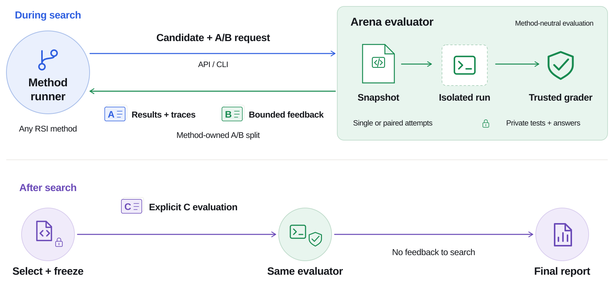</a>

In AgentPilot's Arena integration, the seen tasks serve two roles: development and validation. A separate test set measures generalization after the final candidate is frozen:

| Split | Purpose | How results are used |
| --- | --- | --- |
| **A — Development** | Develop and debug candidates | Task-level evidence supports implementation and focused experiments. |
| **B — Validation** | Compare candidates and guide search | Repeated, budgeted feedback informs candidate selection and improvement decisions. |
| **C — Test** | Measure generalization to unseen tasks | Evaluated after search ends and the final candidate is frozen; results never feed back into improvement. |

Arena provides evaluation while each method retains its own search and selection policy. AgentPilot connects through its [Arena integration](../../agentpilot/integrations/arena/README.md).

## Experimental Setup

To compare Codex, DeepSeek Harness, OpenEvolve and ShinkaEvolve, follow the [baseline run guide](../README.md#quick-start) after [installing Arena](../../README.md#quick-start-arena).

In the experiments below, all methods evolve the same Harbor Terminus 2 harness within each benchmark. The task-facing model runs inside Terminus 2, while the outer model searches for and implements harness improvements.

| Setting                                 | AIME 2024+2025                                                                                   | Terminal-Bench 2.1                                                                               |
| --------------------------------------- | ------------------------------------------------------------------------------------------------ | ------------------------------------------------------------------------------------------------ |
| **A / B / C tasks**                     | 6 / 18 / 36                                                                                      | 16 / 24 / 49                                                                                     |
| **Evolved program**                     | Terminus 2 + Qwen 3.5 9B, temperature 0                                                          | Terminus 2 + DeepSeek V4 Flash 0731, temperature 0                                               |
| **Outer search / implementation model** | DeepSeek V4 Flash 0731                                                                           | DeepSeek V4 Flash 0731                                                                           |
| **B feedback**                          | AgentPilot and baselines use a 9-of-18 B wave.                                                    | AgentPilot and baselines use a 12-of-24 B wave.                                                   |
| **Search budget**                       | AgentPilot: 10 batches × 2 actions = 20 actions per carrier. Baselines: 10 candidates per method. | AgentPilot: 10 batches × 2 actions = 20 actions per carrier. Baselines: 10 candidates per method. |
| **AgentPilot policy proposer**           | Qwen 3.5 9B, temperature 0.3                                                                     | Qwen 3.5 9B, temperature 0.3                                                                     |
| **Selection and final test**            | Freeze the best B program, then evaluate it once on all 36 C tasks.                              | Freeze the best B program, then evaluate it once on all 49 C tasks.                              |

## Observed Baseline Results

### AIME 2024+2025

The baseline results contain privacy-minimized aggregate evidence from Codex, DeepSeek Harness, OpenEvolve, and ShinkaEvolve. Each method produced ten candidate occurrences, sampled its own 9-of-18 B subset, and froze one B-selected candidate before C was opened.

<a href="../../assets/results/baselines/aime-formal.png">
  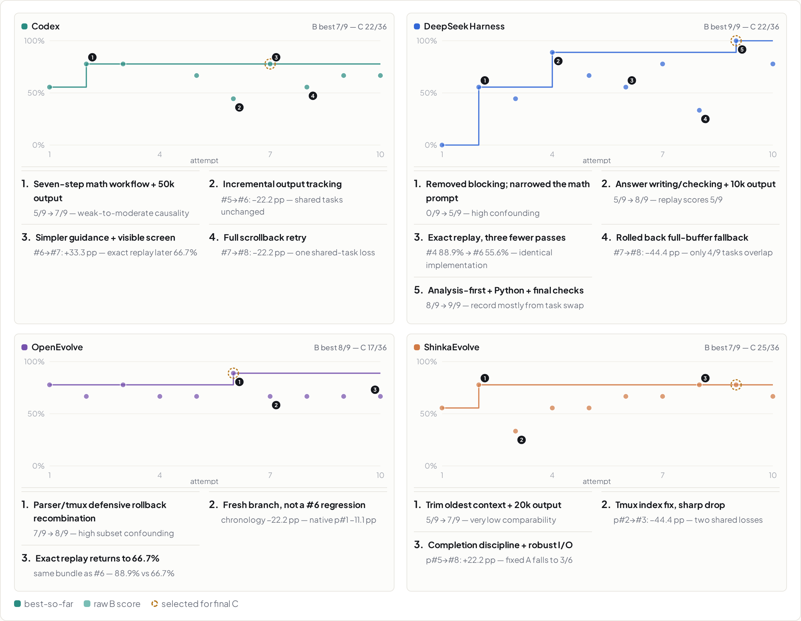
</a>

The observed runs reveal three patterns:

- **B and C rank candidates differently:** DeepSeek Harness reaches `9/9` on B but ties Codex at `22/36` on C. OpenEvolve reaches `8/9` on B but falls to `17/36` on C, while ShinkaEvolve produces the strongest C result (`25/36`) from a `7/9` B candidate.
- **Replay variance is material:** an identical DeepSeek Harness implementation scores `8/9` and `5/9`, while an OpenEvolve replay scores `8/9` and `6/9`.
- **B guides search rather than serving as a leaderboard:** a 9-task B wave is useful for candidate selection, but is too variable to provide a stable ranking or causal effect estimate.

### Terminal-Bench 2.1

The Terminal-Bench panel reports the same four methods over ten candidate occurrences. Each B evaluation samples 12 of 24 validation tasks; apparatus exclusions leave 9–12 conclusive tasks for an individual candidate. C evaluates the selected candidate on all 49 test tasks.

<a href="../../assets/results/baselines/tb21-formal.png">
  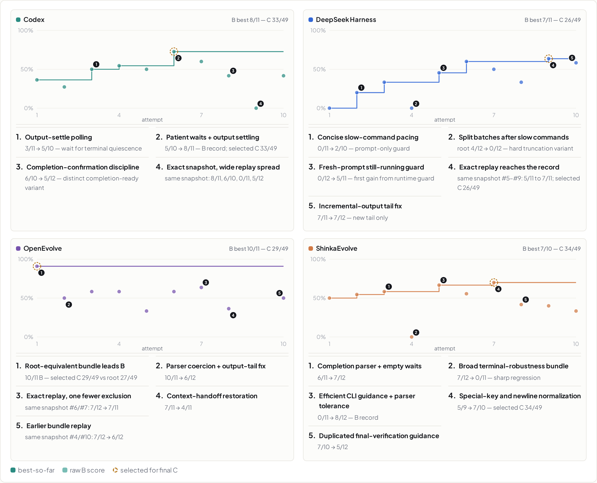
</a>

The Terminal-Bench runs reinforce the distinction between search feedback and generalization:

- **The strongest B candidate is not the strongest C candidate:** OpenEvolve reaches `10/11` on B and `29/49` on C, while ShinkaEvolve reaches `7/10` on B and the strongest C result at `34/49`.
- **Replay variance remains visible:** the same Codex snapshot scores `8/11`, `6/10`, `0/11`, and `5/12`; the same DeepSeek Harness snapshot ranges from `5/11` to `7/11`.
- **C exposes both gains and regressions:** relative to the `27/49` root, Codex reaches `33/49`, ShinkaEvolve reaches `34/49`, OpenEvolve reaches `29/49`, and DeepSeek Harness falls to `26/49`.

## AgentPilot Results

The results below track agent performance, how trial feedback changes policy decisions, and which development paths receive further exploration.

**UCB** denotes UCB-based Policy Learning, and **Textual** denotes Textual Policy Learning. Both update policy state from feedback while keeping language-model weights fixed.

### 1. Search & Generalization Evaluation

B provides adaptive feedback during improvement. C stays outside the search loop until the run and B-selected candidate are frozen.

The source scenarios assign initial scores of 20/36 on AIME and 22/49 on Terminal-Bench. The separate Terminal-Bench baseline runs above start at 27/49, so their gains use a different reference point.

| Method        | Selected on B |       Final C | Gain over C root |
| ------------- | ------------: | ------------: | ---------------: |
| AIME UCB      | 17/18 (94.4%) | 28/36 (77.8%) |            +8/36 |
| AIME Textual  |  18/18 (100%) | 25/36 (69.4%) |            +5/36 |
| TB2.1 UCB     | 20/24 (83.3%) | 31/49 (63.3%) |            +9/49 |
| TB2.1 Textual | 21/24 (87.5%) | 34/49 (69.4%) |           +12/49 |

Across the four runs:

- **B selection and C generalization can disagree:** AIME Textual finds the higher B primary (`18/18` versus `17/18`), while UCB finishes `3/36` higher on C.
- **Policy learning behavior changes by benchmark:** on TB2.1, Textual leads UCB on both B (`+1/24`) and C (`+3/49`).
- **Gates separate score from admission:** AIME UCB attempt `#1` scores `18/18` on B but is rejected for implementation deviation and later scores `18/36` on C. Attempt `#4` enters the archive at `13/18` because admission depends on paired improvement and constraints rather than absolute B score alone.

#### AIME: UCB

<a href="../../assets/results/bc/aime-ucb.png">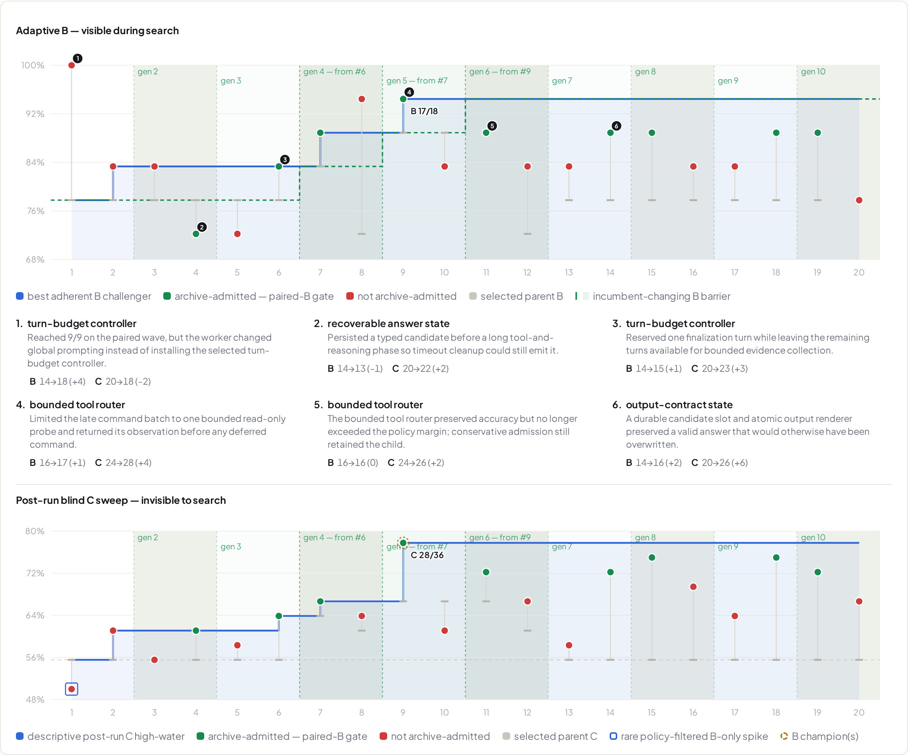</a>

#### AIME: Textual

<a href="../../assets/results/bc/aime-memory.png">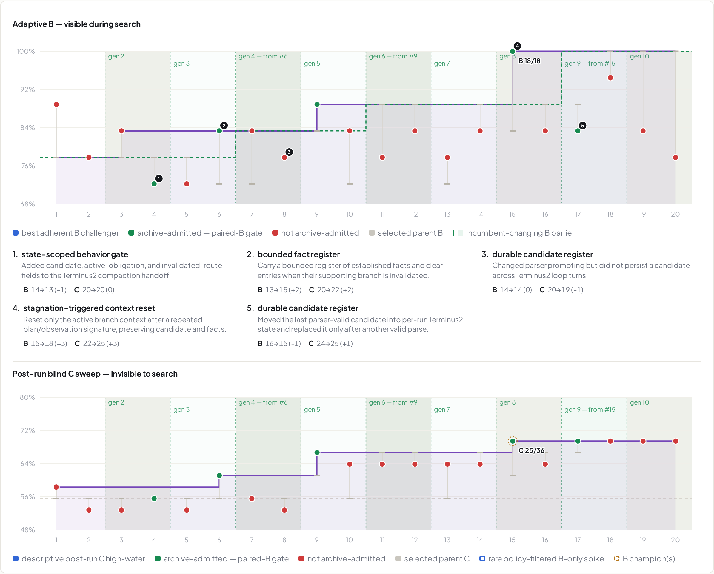</a>

#### Terminal-Bench 2.1: UCB

<a href="../../assets/results/bc/tb21-ucb.png">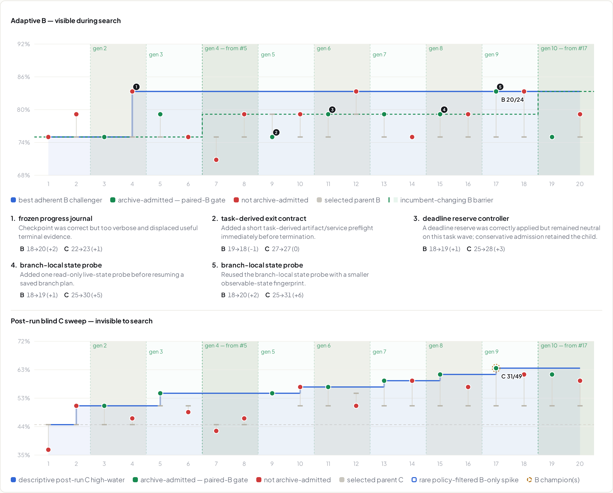</a>

#### Terminal-Bench 2.1: Textual

<a href="../../assets/results/bc/tb21-memory.png">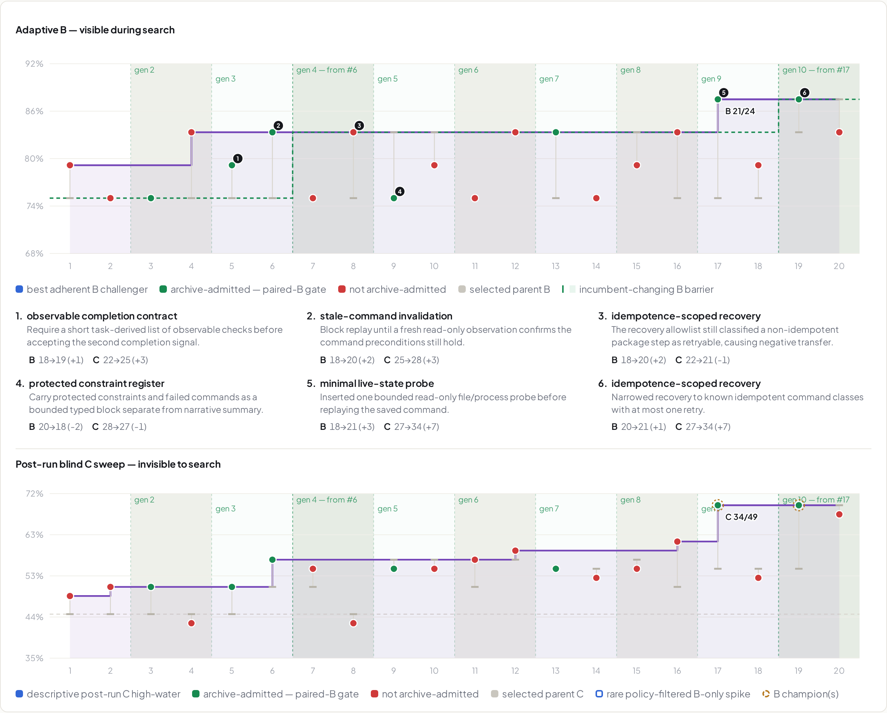</a>

### 2. Policy Evolution

AgentPilot updates policy from attributable, search-visible B evidence at batch barriers. UCB updates parent and direction outcome statistics; Textual adds, revises, reuses, or retires bounded lessons in Policy Memory. These learned statistics or lessons guide the next batch's parent, direction-allocation, and proposal-selection decisions.

The policy plots highlight three dynamics:

- **UCB keeps uncertainty explicit:** AIME ends with 5 registered arms and TB2.1 with 6. Repeated negative evidence pushes some indices as low as `0.72` on AIME and `0.60` on TB2.1, while successful or underexplored arms remain near `1.00`. These are optimistic selection indices, not success probabilities.
- **Textual revises rather than only grows:** AIME performs 6 additions, 8 revisions, and 1 retirement to finish with 5 active lessons. TB2.1 performs 7 additions and 8 revisions to finish with 7 active lessons.
- **Updates happen at the batch barrier:** each Bn column shows the policy frozen before batch n, and that batch's outcomes appear only in the next column.

#### AIME: UCB

<a href="../../assets/results/policy/aime-ucb.png">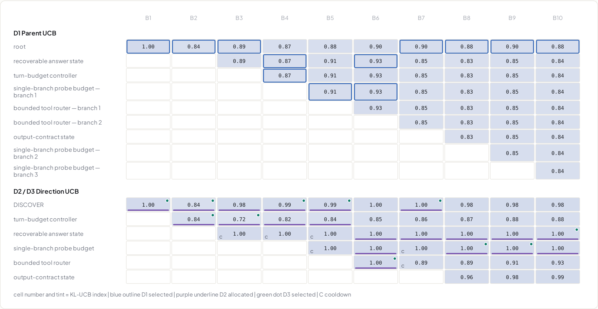</a>

#### AIME: Textual

<a href="../../assets/results/policy/aime-memory.png">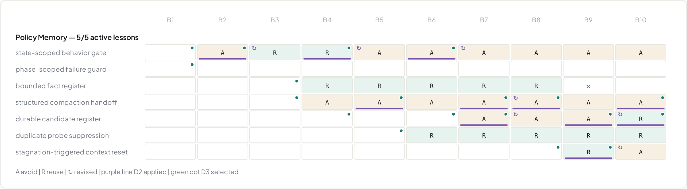</a>

#### Terminal-Bench 2.1: UCB

<a href="../../assets/results/policy/tb21-ucb.png">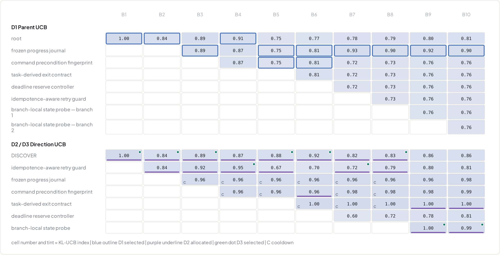</a>

#### Terminal-Bench 2.1: Textual

<a href="../../assets/results/policy/tb21-memory.png">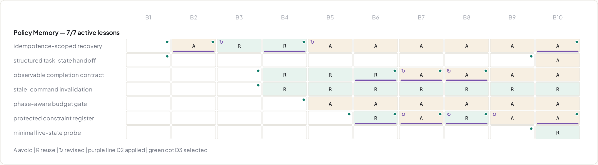</a>

### 3. Program Lineage

Every attempt remains connected to its selected parent, implementation outcome, paired-B admission decision, and archive transition. Rejected and non-attributable attempts remain visible as evidence for later search.

The lineage plots highlight three structural facts:

- **Archive admission differs by method and benchmark:** of 20 attempts, AIME admits 9 under UCB and 5 under Textual; TB2.1 admits 8 under UCB and 7 under Textual. Other branches remain visible without becoming searchable parents.
- **The B-selected primary is frozen before C:** AIME selects UCB `#9` at `17/18` B and `28/36` C, and Textual `#15` at `18/18` B and `25/36` C. TB2.1 selects UCB `#17` at `20/24` B and `31/49` C, and Textual `#17` at `21/24` B and `34/49` C; `#19` ties on B but does not replace the frozen primary.
- **Edges encode different relationships:** green edges show admitted ancestry, while dashed purple Textual edges show cross-branch evidence reuse rather than parentage.

#### AIME: UCB

<a href="../../assets/results/lineage/aime-ucb.png">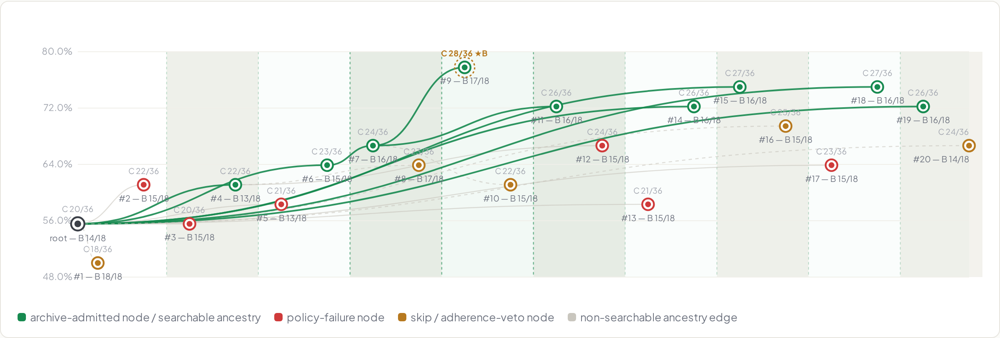</a>

#### AIME: Textual

<a href="../../assets/results/lineage/aime-memory.png">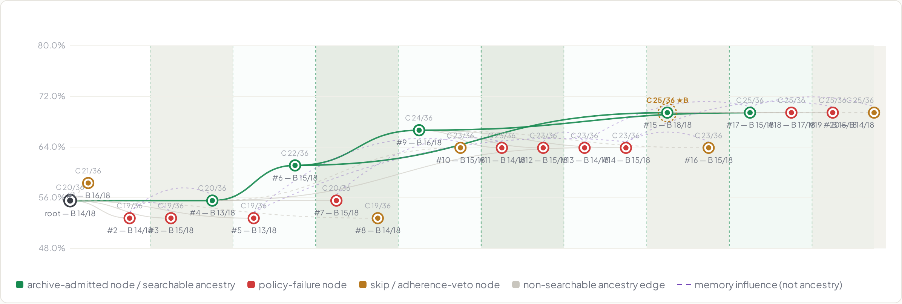</a>

#### Terminal-Bench 2.1: UCB

<a href="../../assets/results/lineage/tb21-ucb.png">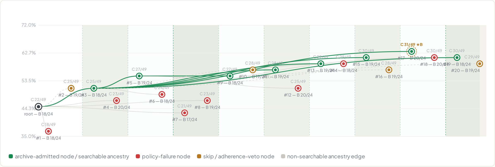</a>

#### Terminal-Bench 2.1: Textual

<a href="../../assets/results/lineage/tb21-memory.png">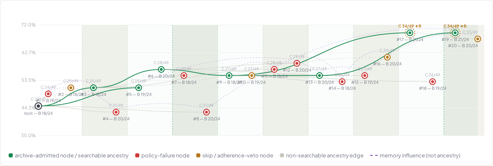</a>
